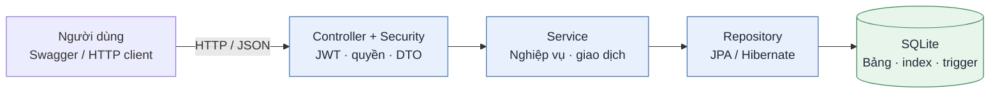
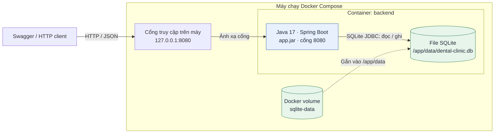

# Hệ thống đặt lịch phòng khám nha khoa

Dự án xây dựng REST API để tiếp nhận yêu cầu khám, phân công bác sĩ và theo dõi lịch hẹn tại phòng khám nha khoa. Hệ thống có ba nhóm người dùng: khách hàng, quản trị viên (Admin) và bác sĩ.

## 1. Bài toán và phạm vi

Khách hàng thường chọn giờ khám theo nhu cầu cá nhân, trong khi phòng khám cần sắp xếp dựa trên thời lượng dịch vụ và lịch của từng bác sĩ. Vì vậy, hệ thống tách **giờ khách mong muốn** khỏi **lịch khám được phân công**. Một yêu cầu đặt lịch chỉ chiếm giờ của bác sĩ sau khi Admin phân công.

| Vai trò | Chức năng |
| --- | --- |
| Khách hàng | Xem phòng khám, dịch vụ, bác sĩ và lịch trống; gửi yêu cầu khám; tra cứu hoặc hủy bằng mã hẹn, không cần tài khoản. |
| Admin | Xem các yêu cầu, phân công hoặc đổi bác sĩ và giờ khám; quản lý, cập nhật và vô hiệu hóa tài khoản bác sĩ. |
| Bác sĩ | Xem lịch được giao, xác nhận, hoàn thành hoặc hủy lịch; xem và cập nhật hồ sơ cá nhân. |

Phạm vi hiện tại là backend. Giao diện người dùng, thanh toán, hồ sơ bệnh án và thông báo email/SMS chưa được triển khai.

## 2. Quy trình đặt lịch

Khách gửi yêu cầu ở trạng thái **PENDING**. Admin chọn bác sĩ và thời gian thực tế, chuyển lịch sang **ASSIGNED**. Bác sĩ có thể xác nhận thành **CONFIRMED**, sau đó đánh dấu **COMPLETED** khi khám xong. Hệ thống cũng cho phép hoàn thành trực tiếp từ ASSIGNED. Lịch chưa kết thúc có thể chuyển sang CANCELLED theo quyền của người thao tác; COMPLETED và CANCELLED không được mở lại.

Các quy tắc chính:

- Thời gian khám phải ở tương lai, bắt đầu theo bước 30 phút và nằm trọn trong giờ mở cửa, kể cả thời lượng dịch vụ.
- Hai ca của cùng bác sĩ, cùng ngày bị trùng nếu `start_cũ < end_mới && end_cũ > start_mới`. Hai ca 09:00–10:00 và 10:00–10:30 được phép nối tiếp.
- ASSIGNED, CONFIRMED và COMPLETED chiếm giờ; PENDING và CANCELLED không chặn lịch. Danh sách giờ trống chỉ mang tính tham khảo, không giữ chỗ cho khách.
- Service kiểm tra lịch trước khi phân công. Trigger SQLite kiểm tra lại khi ghi dữ liệu; xung đột trả HTTP 409. Trường `@Version` phát hiện cập nhật đồng thời trên cùng bản ghi.
- Khách chỉ hủy trước giờ hẹn. Bác sĩ không được truy cập lịch của người khác. Admin không thể vô hiệu hóa bác sĩ đang còn lịch ASSIGNED hoặc CONFIRMED.

## 3. Thiết kế và tổ chức mã nguồn

Backend sử dụng **Java 17, Spring Boot 3.5.16, Spring Data JPA/Hibernate, Spring Security và SQLite**. Request đi qua bộ lọc xác thực, Controller, Service và Repository trước khi truy cập dữ liệu.

### Luồng xử lý request



Các API công khai không yêu cầu token; API Admin và bác sĩ được kiểm tra quyền trước khi vào Controller. Luồng xử lý này giữ nguyên khi chạy ứng dụng trực tiếp bằng Java hoặc đóng gói bằng Docker.

### Triển khai bằng Docker Compose



Docker đóng gói môi trường Java và chạy `app.jar` trong container `backend`. Compose ánh xạ cổng 8080 của container ra `127.0.0.1:8080` trên máy; có thể đổi cổng phía máy bằng `HOST_PORT`. SQLite được ứng dụng đọc/ghi trực tiếp qua JDBC.

Đường nét đứt biểu diễn **volume `sqlite-data` được gắn vào thư mục `/app/data` của container**. File `/app/data/dental-clinic.db` được lưu trong volume, nên tạo lại container vẫn giữ dữ liệu nếu giữ volume. Khi chạy bằng Maven/Java tại máy, file mặc định là `dental-clinic.db` trong thư mục chạy ứng dụng; `DB_PATH` cho phép đổi vị trí lưu.

| Thành phần | Trách nhiệm |
| --- | --- |
| `src/main/java/com/dental/controller/`, `dto/` | Nhận request HTTP, kiểm tra đầu vào, chuyển đổi DTO và trả response JSON. |
| `service/` | Xử lý nghiệp vụ đặt lịch, phân công, quản lý bác sĩ và xác thực; xác định ranh giới giao dịch. |
| `repository/`, `entity/` | Truy cập dữ liệu qua Spring Data JPA và ánh xạ sáu bảng: accounts, doctors, clinics, dental_services, appointments, login_sessions. |
| `security/`, `exception/`, `config/` | Kiểm tra JWT và quyền truy cập, ánh xạ lỗi nghiệp vụ sang HTTP, cấu hình và khởi tạo dữ liệu. |
| `src/main/resources/` | `schema.sql` định nghĩa bảng, index và trigger SQLite; `application.yml` cấu hình kết nối, profile và JWT. |
| `src/test/`, `.github/workflows/ci.yml` | Kiểm thử API, ranh giới kiến trúc, profile local và quá trình chạy bằng Docker. |

Controller xử lý HTTP, còn Service trả kết quả hoặc ném `BusinessException`. Tầng Service không import thư viện HTTP, Servlet, JPA hay JDBC; quy tắc này được kiểm tra bằng ArchUnit. Spring vẫn quản lý Service và giao dịch qua `@Service`, `@Transactional`.

Mật khẩu được băm bằng BCrypt. JWT có thời hạn 120 phút và gắn với phiên đăng nhập trong database. Bộ lọc kiểm tra cả token, phiên và trạng thái tài khoản, nên đăng xuất hoặc vô hiệu hóa tài khoản sẽ thu hồi quyền truy cập. Dữ liệu trả về không chứa password hash.

## 4. Cài đặt và API

Cần JDK 17 trở lên hoặc Docker. SQLite lưu dữ liệu trong file nên không cần cài database server.

```bash
./mvnw -B verify
./mvnw spring-boot:run
# Trên Windows dùng .\mvnw.cmd thay cho ./mvnw
# Hoặc chạy bằng Docker:
docker compose up -d --build
```

API chạy tại http://localhost:8080; Swagger UI tại http://localhost:8080/swagger-ui/index.html. Profile demo có các tài khoản `admin / Admin123!`, `doctor1 / Doctor123!` và `doctor2 / Doctor123!`. Docker lưu database trong volume; `docker compose down` giữ lại dữ liệu.

[Đặc tả OpenAPI JSON](openapi.json) mô tả 26 API: 8 public, 3 xác thực, 5 dành cho bác sĩ và 10 dành cho Admin. Có thể đọc bằng [Swagger preview](https://petstore.swagger.io/?url=https%3A%2F%2Fraw.githubusercontent.com%2FFlowBoat123%2FKTPM-BTL%2Fmain%2Fopenapi.json); để gửi request, dùng Swagger UI của backend đang chạy. JSON có ví dụ đăng nhập, đặt lịch, phân công và đổi trạng thái.

Các API dùng GET, POST, DELETE, PUT và PATCH. Chẳng hạn, `GET /api/admin/appointments` và `POST /api/admin/doctors` đều yêu cầu token ADMIN. Mã lỗi gồm 400 khi đầu vào sai, 401 khi chưa xác thực, 403 khi không đủ quyền, 404 khi không tìm thấy dữ liệu và 409 khi xung đột. Xuất lại đặc tả bằng `python scripts/export_openapi.py`.

## 5. Kiểm thử và đánh giá hiệu năng

Bộ kiểm thử Java gồm **20 test**: 18 test tích hợp API, một test ranh giới kiến trúc và một test profile local. Các trường hợp được kiểm tra gồm phân quyền, chuyển trạng thái, trùng giờ, thu hồi phiên và hai yêu cầu phân công chồng giờ chạy đồng thời. Test dùng database tạm. Script `python scripts/docker_smoke.py` kiểm tra thêm luồng API và khả năng giữ dữ liệu SQLite sau khi container khởi động lại.

### Cấu hình đo trên Kaggle

Lần đo ngày **26/10/2026** sử dụng SQLite và mã nguồn tại commit `298d97fcd96d0bb89c617bba782f47d2a4f23584`. Máy Kaggle có CPU Xeon 2,20 GHz, 4 CPU logic với quota 4 CPU và RAM giới hạn 30 GiB. Backend chạy JDK 17, heap 512 MiB, pool một kết nối SQLite, journal mode `delete`. Locust và backend cùng dùng tài nguyên máy này.

Locust tạo các phiên giả lập, giữ **một phiên Admin** ở mỗi mức; số bác sĩ lần lượt là 5, 10, 20 và số khách hàng là 100, 200, 500. Mỗi bác sĩ đăng nhập bằng tài khoản riêng. Khách đọc thông tin, xem lịch trống, đặt và tra cứu lịch; 20% yêu cầu mới được hủy ngay. Admin đọc và phân công; bác sĩ xem, xác nhận và hoàn thành lịch. Giữa các tác vụ có thời gian nghỉ 1–2,5 giây.

Sau khi tạo đủ phiên và đăng nhập xong, bộ đo làm nóng 15 giây, đặt lại thống kê rồi đo 120 giây với các phiên đang có. Login và warm-up được lưu riêng. Mỗi mức chạy một lần, với database mới; thời gian đo thực tế là 120,05–120,24 giây do chờ các request cuối kết thúc.

### Kết quả

| Khách / bác sĩ / Admin | Request | Request/giây | Trung bình (ms) | P95 (ms) | Lỗi |
| --- | ---: | ---: | ---: | ---: | ---: |
| 100 / 5 / 1 | 16.280 | 135,61 | 6,53 | 22 | 0% |
| 200 / 10 / 1 | 32.477 | 270,50 | 10,26 | 32 | 0% |
| 500 / 20 / 1 | 68.116 | 566,49 | 147,20 | 310 | 0% |

P95 thể hiện mức độ trễ mà khoảng 95% request không vượt quá. Khi tăng từ 200 lên 500 khách, throughput tiếp tục tăng nhưng độ trễ tăng rõ: P95 từ 32 lên 310 ms. Không có request lỗi trong ba cửa sổ đo này.

Ở mức lớn nhất có 2.906 lượt đặt lịch nhưng chỉ 41 lượt phân công. Điều này cho thấy tốc độ xử lý yêu cầu nghiệp vụ của một Admin thấp hơn tốc độ tạo yêu cầu trong kịch bản. Vì vậy, throughput API không thể dùng thay cho số ca khám được xử lý hoàn tất. Kết quả chỉ áp dụng cho commit và kịch bản đã đo; phần khóa phân công bổ sung sau lần đo này chưa có số liệu Kaggle mới.

Số liệu được lưu tại [CSV tổng hợp](performance/kaggle-20261026/comparison.csv), [notebook đã thực thi](notebooks/results/fixed_admin_kaggle_20261026.ipynb) và [ZIP gốc](performance/kaggle-20261026/results.zip) chứa metadata, CSV và log từng mức. [Bản Kaggle](https://www.kaggle.com/code/flowboat/ktpm-phase-1-sqlite-cpu-baseline?scriptVersionId=362443343) hiện riêng tư; notebook có output đã được lưu trong repository.

Để chạy lại, import [notebook mẫu](notebooks/phase1_sqlite_kaggle.ipynb) vào Kaggle, chọn Accelerator None, Internet On rồi Save & Run All. Notebook mẫu lấy mã từ `main` và ghi lại commit thực tế. Notebook kết quả cố định commit nêu trên để tái lập phép đo. Có thể chạy thử ở máy bằng cách cài `requirements-load.txt`, sau đó dùng `python scripts/run_load_test.py --environment local --customers 10 --doctors 3 --spawn-rate 10 --warmup 2 --duration 8 --output reports/local-smoke`.

## 6. Hạn chế và hướng phát triển

Danh sách lịch hẹn hiện chưa phân trang, nên khi dữ liệu tăng, việc tải và xem danh sách sẽ bất tiện hơn. Phòng khám cũng chưa thể khai báo lịch nghỉ riêng cho bác sĩ, và người dùng chưa có chức năng đổi mật khẩu. Về nghiệp vụ, mọi yêu cầu đặt lịch đều cần Admin phân công; nếu khách đặt nhiều hơn khả năng xử lý của Admin, các yêu cầu PENDING sẽ dồn lại dù API vẫn phản hồi bình thường.

SQLite giúp việc cài đặt đơn giản, nhưng cấu hình hiện tại chỉ dùng một kết nối database. Mỗi request cần đăng nhập cũng phải kiểm tra phiên trong database. Hai điểm này cần được đo kỹ hơn khi tăng tải. Dự án chưa có công cụ quản lý thay đổi schema, nên việc cập nhật cấu trúc bảng khi đã có dữ liệu cũng cần được bổ sung.

Các lần kiểm thử vừa rồi cho biết hệ thống hoạt động ra sao ở ba mức tải đã chọn, nhưng chưa đủ để kết luận tải tối đa vì mỗi mức mới chạy một lần. Hướng tiếp theo là bổ sung phân trang, lịch nghỉ và đổi mật khẩu; đồng thời chạy lặp lại phép đo, theo dõi CPU, truy vấn và thời gian chờ kết nối. Sau mỗi thay đổi, cần đo lại với cùng phần cứng, dữ liệu và kịch bản để biết cải tiến có hiệu quả đến đâu.

Yêu cầu bài tập: [Kiến trúc phần mềm 2026](https://github.com/maytinhdibo/KTPM-architecture-solution/blob/main/2026.md).
