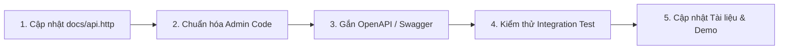

# KẾ HOẠCH HÀNH ĐỘNG (ACTION PLAN): MODULE ADMIN ENDPOINTS

> **Vai trò của bạn trong nhóm**: Người chịu trách nhiệm phát triển, hoàn thiện, kiểm thử và tài liệu hóa toàn bộ **Module Quản trị viên (Admin Endpoints)** của hệ thống Dental Clinic Backend (Đồ án KTPM-BTL 2026 - Pha 1).

---

## I. MỤC TIÊU VÀ PHẠM VI TRÁCH NHIỆM

Bạn phụ trách **10 endpoint quản trị** thuộc tiền tố `/api/admin/**`:
1. **Quản lý lịch hẹn**:
   - `GET /api/admin/appointments`: Xem tất cả lịch hẹn của hệ thống.
   - `GET /api/admin/appointments/{id}`: Xem chi tiết 1 lịch hẹn.
   - `PATCH /api/admin/appointments/{id}/assign`: Phân công bác sĩ, ngày và giờ khám thực tế.
   - `PATCH /api/admin/appointments/{id}/status`: Đổi trạng thái lịch hẹn theo quy tắc nghiệp vụ.
2. **Quản lý bác sĩ**:
   - `GET /api/admin/doctors`: Xem danh sách tất cả bác sĩ (kể cả đã vô hiệu hóa).
   - `POST /api/admin/doctors`: Tạo tài khoản đăng nhập và hồ sơ bác sĩ mới.
   - `GET /api/admin/doctors/{id}`: Xem chi tiết hồ sơ bác sĩ.
   - `PUT /api/admin/doctors/{id}`: Cập nhật hồ sơ bác sĩ.
   - `DELETE /api/admin/doctors/{id}`: Vô hiệu hóa tài khoản bác sĩ (giữ nguyên lịch sử).
   - `GET /api/admin/doctors/{id}/appointments`: Xem toàn bộ lịch hẹn được phân công cho 1 bác sĩ.

---

## II. CHECKLIST CHI TIẾT NHỮNG VIỆC BẠN CẦN LÀM

### 1. Nhiệm vụ 1: Hoàn thiện kịch bản kiểm thử trong `docs/api.http`
* **Vấn đề hiện tại**: File `docs/api.http` hiện mới chỉ có 1 request của Admin (`/assign`), thiếu 9 request còn lại.
* **Việc cần làm**:
  - [ ] Bổ sung các biến môi trường tiện ích: `@adminToken = paste-admin-token`, `@doctorId = 1`, `@appointmentId = 1`.
  - [ ] Thêm request `GET /api/admin/appointments` (Xem toàn bộ lịch).
  - [ ] Thêm request `GET /api/admin/appointments/{{appointmentId}}` (Xem chi tiết lịch).
  - [ ] Thêm request `PATCH /api/admin/appointments/{{appointmentId}}/status` với body `{"status":"CANCELLED"}`.
  - [ ] Thêm request `GET /api/admin/doctors` (Xem danh sách bác sĩ).
  - [ ] Thêm request `POST /api/admin/doctors` với body JSON mẫu tạo tài khoản + hồ sơ bác sĩ đầy đủ.
  - [ ] Thêm request `GET /api/admin/doctors/{{doctorId}}` (Xem chi tiết bác sĩ).
  - [ ] Thêm request `PUT /api/admin/doctors/{{doctorId}}` với body JSON mẫu cập nhật bác sĩ.
  - [ ] Thêm request `DELETE /api/admin/doctors/{{doctorId}}` (Vô hiệu hóa tài khoản).
  - [ ] Thêm request `GET /api/admin/doctors/{{doctorId}}/appointments` (Xem lịch của bác sĩ).

---

### 2. Nhiệm vụ 2: Rà soát & Chuẩn hóa mã nguồn Java của Admin
* **Các file phụ trách**: `AdminController.java`, `DoctorService.java`, `AppointmentService.java`, `Requests.java`, `Responses.java`.
* **Việc cần làm**:
  - [ ] **Validation đầu vào (`@Valid`)**: Đảm bảo các DTO (`DoctorCreate`, `DoctorUpdate`, `Assignment`, `StatusChange`) bắt buộc kiểm tra định dạng email, số điện thoại, mật khẩu $\ge$ 8 ký tự, ngày giờ ở tương lai, không cho phép JSON chứa thuộc tính lạ (`fail-on-unknown-properties`).
  - [ ] **HTTP Status Codes chuẩn RESTful**:
    - `POST /api/admin/doctors` $\rightarrow$ Trả về `201 CREATED`.
    - `DELETE /api/admin/doctors/{id}` $\rightarrow$ Trả về `204 NO CONTENT`.
    - `GET`, `PUT`, `PATCH` $\rightarrow$ Trả về `200 OK`.
  - [ ] **Bảo mật dữ liệu**: Tuyệt đối không để lộ hash mật khẩu trong `DoctorView` hay `AppointmentView`.
  - [ ] **Phân quyền chặt chẽ**: Đảm bảo đường dẫn `/api/admin/**` chỉ tài khoản có role `ADMIN` mới truy cập được (tài khoản thường hoặc DOCTOR truy cập phải nhận mã `403 FORBIDDEN`, chưa đăng nhập nhận `401 UNAUTHORIZED`).

---

### 3. Nhiệm vụ 3: Tích hợp OpenAPI / Swagger UI cho nhóm Admin
* **Mục tiêu**: Đáp ứng yêu cầu đề bài *"Có tài liệu API (OpenAPI/Swagger)"*.
* **Việc cần làm**:
  - [ ] Gắn `@Tag(name = "Admin", description = "Các API quản trị hệ thống phòng khám, phân công lịch và quản lý bác sĩ")` lên class `AdminController`.
  - [ ] Gắn chú thích `@Operation(summary = "...", description = "...")` cho từng endpoint trong 10 endpoint của Admin.
  - [ ] Gắn chú thích `@SecurityRequirement(name = "BearerAuth")` để Swagger UI hiển thị biểu tượng ổ khóa, cho phép paste token Admin trực tiếp để test trên giao diện web.
  - [ ] Gắn các `@ApiResponse` mô tả các tình huống lỗi thường gặp: `400 (Dữ liệu không hợp lệ)`, `401 (Chưa đăng nhập)`, `403 (Không có quyền Admin)`, `404 (Không tìm thấy)`, `409 (Trùng lịch / Trùng username / Vô hiệu hóa bác sĩ còn lịch mở)`.

---

### 4. Nhiệm vụ 4: Kiểm thử tự động (Integration Testing)
* **File phụ trách**: `src/test/java/com/dental/ApiIntegrationTest.java`.
* **Việc cần làm**:
  - [ ] Đảm bảo bộ test tự động kiểm thử toàn diện các kịch bản của Admin:
    1. Admin đăng nhập thành công và lấy JWT.
    2. Admin xem danh sách cuộc hẹn và chi tiết cuộc hẹn.
    3. Admin phân công bác sĩ thành công $\rightarrow$ chuyển sang `ASSIGNED`.
    4. Phân công trùng giờ ca khám của cùng bác sĩ $\rightarrow$ Bị từ chối với mã `409 Conflict`.
    5. Đổi trạng thái lịch trái phép (ví dụ `PENDING` thành `COMPLETED`) $\rightarrow$ Bị từ chối `409 Conflict`.
    6. Tạo bác sĩ mới thành công $\rightarrow$ `201 Created`; tạo trùng username $\rightarrow$ `409 Conflict`.
    7. Cập nhật hồ sơ bác sĩ thành công $\rightarrow$ `200 OK`.
    8. Vô hiệu hóa bác sĩ khi còn lịch `ASSIGNED`/`CONFIRMED` $\rightarrow$ Bị chặn `409 Conflict`.
    9. Vô hiệu hóa bác sĩ khi không còn lịch mở $\rightarrow$ Thành công `204 No Content`, token cũ của bác sĩ bị thu hồi ngay lập tức (không gọi được API nữa).
    10. Bác sĩ hoặc khách truy cập vào URL Admin $\rightarrow$ Bị chặn `403 Forbidden` / `401 Unauthorized`.
  - [ ] Chạy lệnh kiểm thử để xác nhận: `.\mvnw.cmd test` (Windows) hoặc `./mvnw test` (Linux).

---

### 5. Nhiệm vụ 5: Nghiệm thu & Demo
- [ ] Chuẩn bị kịch bản demo chạy file `docs/api.http` từ đầu đến cuối trước nhóm / giảng viên:
  1. Login Admin.
  2. Xem danh sách lịch khách gửi (`PENDING`).
  3. Phân công bác sĩ và giờ khám (`ASSIGNED`).
  4. Tạo thêm 1 bác sĩ mới.
  5. Cập nhật thông tin bác sĩ.
  6. Demo cơ chế bảo vệ: Cố tình phân công trùng giờ hoặc vô hiệu hóa bác sĩ đang có lịch khám để chứng minh hệ thống bắt lỗi chuẩn `409 Conflict`.
