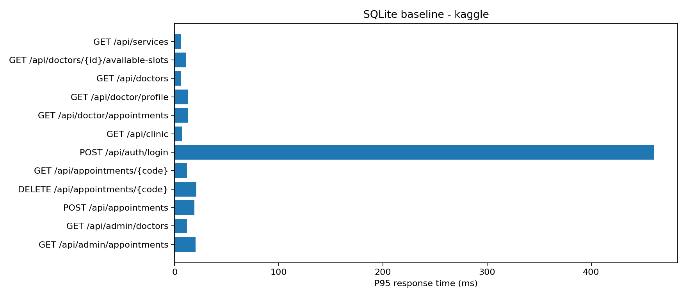

# Đối chiếu nghiệm thu Pha 1

Nguồn yêu cầu: [2026.md](https://github.com/maytinhdibo/KTPM-architecture-solution/blob/main/2026.md).

| Yêu cầu | Hiện thực / bằng chứng |
| --- | --- |
| REST JSON, GET/POST/DELETE | 26 endpoint; `docs/api.http`, DTO và test tích hợp. |
| OpenAPI/Swagger | `/v3/api-docs`, `/swagger-ui/index.html`; test truy cập không cần token. |
| API → nghiệp vụ → dữ liệu; nghiệp vụ không import web/DB library | BusinessException không chứa HTTP; ánh xạ HTTP tại handler; ArchitectureTest kiểm tra phụ thuộc. |
| Repository + ORM | Spring Data JPA / Hibernate và SQLiteDialect. |
| Đăng nhập, GET và POST có xác thực, xử lý tập trung | JWT filter; GET `/api/admin/appointments`, POST `/api/admin/doctors`; kiểm thử 401/403/quyền sở hữu. |
| Docker | Dockerfile + Compose SQLite; `scripts/docker_smoke.py` kiểm tra API và giữ dữ liệu sau restart; CI lưu artifact. |
| GitHub public + README kiến trúc/đặc tả | README, tài liệu API, PR và GitHub Actions. |
| Kaggle CPU | Notebook `notebooks/phase1_sqlite_kaggle.ipynb`; trạng thái thực thi được cập nhật bên dưới. |

## Kiểm tra mã nguồn và Docker

- `mvnw verify`: 19 test, không có lỗi hoặc bỏ qua (17 API, 1 kiến trúc, 1 profile local).
- Bài đo baseline chọn SQLite, pool 1, Java heap 512 MiB. PostgreSQL không phải yêu cầu bắt buộc và không dùng để so sánh baseline Pha 1 này.
- Docker build và smoke test đã đạt ngày 25/10/2026: đặt lịch → phân công → hoàn thành, quyền 401/403, trùng lịch 409, ghi chú dài và dữ liệu còn sau restart. CI chạy lại kiểm tra Docker và lưu artifact theo từng commit.

## Bằng chứng Kaggle lịch sử (trọng số 7/2/1)

Đã chạy trên Kaggle CPU ngày **25/10/2026**, phiên bản notebook **1**, mã nguồn sạch ở commit `8e7b4476e12257292475b1d0aa19ba26ae103ae8`.

- [Notebook đã chạy, version 362009941](https://www.kaggle.com/code/flowboat/ktpm-phase-1-sqlite-cpu-baseline?scriptVersionId=362009941). Notebook đang ở chế độ riêng tư trong tài khoản chủ dự án; bản sao kết quả thô bên dưới nằm trong GitHub công khai để có thể đối chiếu mà không cần đăng nhập Kaggle.
- [Toàn bộ gói bằng chứng ZIP](evidence/kaggle-20261025/results.zip).
- [CSV từng endpoint](evidence/kaggle-20261025/locust_stats.csv), [lịch sử tải](evidence/kaggle-20261025/locust_stats_history.csv), [metadata](evidence/kaggle-20261025/metadata.json), [preflight](evidence/kaggle-20261025/preflight.json), [báo cáo](evidence/kaggle-20261025/REPORT.md).
- [CI kiểm thử Java 17 và Docker trên commit được đo](https://github.com/FlowBoat123/KTPM-BTL/actions/runs/40161994919).

| Thông số | Kết quả |
| --- | --- |
| Môi trường | Kaggle CPU, không GPU/TPU |
| CPU / RAM | Intel Xeon 2.20 GHz; 4 CPU logic; cgroup CPU quota 4; RAM limit 30 GiB |
| Database / JVM | SQLite; pool 1; journal `delete`; JDK 17; heap 512 MiB |
| Tải | 50 users; tăng 5 users/giây; warm-up 15 giây; đo 120 giây (bao gồm giai đoạn tăng users) |
| Request | 6.511 |
| Request lỗi | 0 (0%) |
| Throughput | 54,56 request/giây |
| Độ trễ trung bình | 6,79 ms |
| Độ trễ P95 | 16 ms |

[Ảnh xác nhận kết quả trong notebook Kaggle](evidence/kaggle-20261025/notebook-result.jpg).

Preflight đã đạt: tạo lịch và ghi chú dài, phân công/hoàn thành, thiếu token 401, sai quyền 403, trùng giờ 409 và thu hồi token khi đăng xuất. Dữ liệu nguồn là giả lập. Thống kê đo chính tách khỏi warm-up; gói ZIP giữ cả số liệu warm-up và log.

Đây là kết quả của một cấu hình và một lần đo, không phải giới hạn tải tối đa của hệ thống. Để đánh giá biến thiên hoặc so sánh Pha 2, cần chạy lại cùng cấu hình và có thể lặp nhiều lần.

## Giới hạn

Kịch bản tải mô phỏng Customer/Admin/Doctor và có preflight các luồng chính. Không tuyên bố đã đo mọi API hoặc phân công đồng thời ở tải lớn. Backend và load generator cùng dùng tài nguyên máy Kaggle. Ngưỡng lỗi ≤1% là chỉ tiêu nhóm tự chọn; đề bài không ấn định số users, RPS hay độ trễ.

## Yêu cầu trình bày mới

README được rút gọn, đặc tả 26 API lưu tại openapi.json và có link preview. Dàn ý Google Meet trong MEET_GUIDE.md. Bộ đo mới giữ một Admin, tạo tài khoản bác sĩ riêng và đo sau login/warm-up; xem KAGGLE_LOAD_TEST.md. Kết quả mới được cập nhật vào README sau khi Kaggle thực thi.
