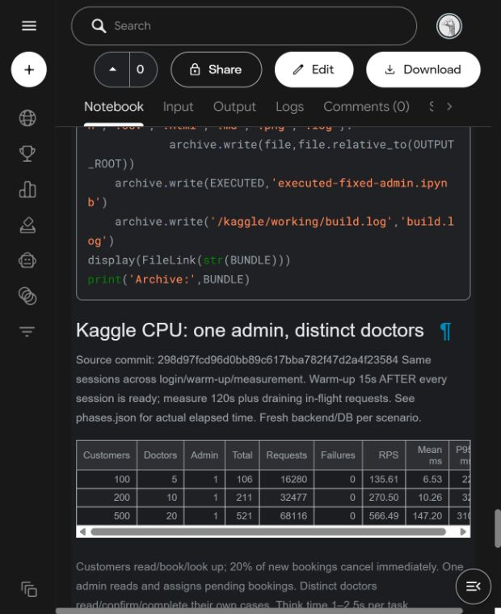

# Kaggle CPU — một Admin cố định, 26/10/2026

Nguồn đo: `298d97fcd96d0bb89c617bba782f47d2a4f23584`, working tree sạch. [Kaggle v4](https://www.kaggle.com/code/flowboat/ktpm-phase-1-sqlite-cpu-baseline?scriptVersionId=362443343), Save & Run All thành công (624,1 giây). Notebook Kaggle riêng tư; bằng chứng đã được lưu tại đây để đọc công khai.

- [Notebook thực thi với output](../../../notebooks/results/fixed_admin_kaggle_20261026.ipynb): bốn cell code execution_count 1–4, không output lỗi; build 19 test thành công.
- [comparison.csv](comparison.csv) / [comparison.json](comparison.json): số tổng hợp; [biểu đồ](scaling.png).
- Mỗi thư mục customers-… giữ metadata.json, phases.json, summary.json, preflight.json, OpenAPI runtime, CSV setup/measurement và báo cáo HTML/PNG. ZIP gốc giữ thêm log build/backend/driver.
- [results.zip](results.zip) tải nguyên từ Output Kaggle, không có DB hay token. SHA-256: `27f1d32291164c983473c415c6572b992bcb53217effeff108b4d7156cf94901`.

Máy: Intel Xeon 2,20 GHz, 4 CPU logic, cgroup quota 4 CPU, RAM giới hạn 30 GiB; Java 17.0.20.1, Python 3.13.15, Locust 2.47.0. SQLite JDBC 3.53.4.0, pool 1, journal delete, JVM heap 512 MiB. Backend và Locust cùng máy.

100 khách + 5 bác sĩ + 1 Admin: 16.280 request, 0 lỗi, 135,61 RPS, trung bình 6,53 ms, P95 22 ms.

200 khách + 10 bác sĩ + 1 Admin: 32.477 request, 0 lỗi, 270,50 RPS, trung bình 10,26 ms, P95 32 ms.

500 khách + 20 bác sĩ + 1 Admin: 68.116 request, 0 lỗi, 566,49 RPS, trung bình 147,20 ms, P95 310 ms.

Đối chiếu sau tải xuống: 120 mẫu history/mức giữ đúng số phiên; phases expected/ready/end trùng nhau; 6/11/21 login chỉ trong setup, measurement không login; tổng request/lỗi khớp CSV gốc, RPS bằng request/thời gian đo thực tế. PATCH phân công và trạng thái bác sĩ có request thực tế ở cả ba mức. RPS CSV gốc Locust có thể lệch nhẹ so với bảng do thời điểm chốt; bảng dùng elapsed trong phases.json.

Ở mức lớn nhất, measurement có 2.906 POST đặt lịch, 41 PATCH phân công và 78 PATCH trạng thái bác sĩ. Tốc độ một Admin xử lý nghiệp vụ hữu hạn; không đồng nhất RPS với số ca khám hoàn tất. Chỉ chạy một lần/mức, chưa đo tải tối đa, chưa dùng để so sánh tối ưu với workload 7/2/1 cũ.

